# Praktikum 4 — CSS Layout

## Identitas Praktikum

- **Nama:** Mu’ammar Kadafi
- **NIM:** 312510192
- **Program Studi/Semester:** Teknik Informatika / 3
- **Mata Kuliah:** Pemrograman Web
- **Dosen Pengampu:** Agung Nugroho, S.Kom., M.Kom.
- **Kelas:** I253C
- **Hari/Tanggal:** Sabtu, 17 Oktober 2026
- **Pertemuan:** 5 (Online)

## Langkah-Langkah Praktikum

### 1. Mempersiapkan Text Editor

Mempersiapkan text editor yang akan digunakan untuk menulis kode program, misalnya Visual Studio Code.

### 2. Membuat Folder Kerja

Membuat folder kerja dengan nama `Lab4Web` sebagai tempat menyimpan file praktikum.

### 3. Membuat File HTML

Membuat file baru dengan nama `lab4_box.html` di dalam folder kerja yang telah dibuat.

### 4. Menuliskan Kode HTML

Pada file `lab4_box.html`, masukkan kode berikut.

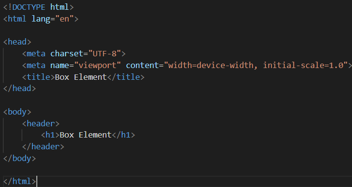

### 5. Membuat Box Element

Kemudian, tambahkan kode untuk membuat box element menggunakan tag `
` seperti berikut.

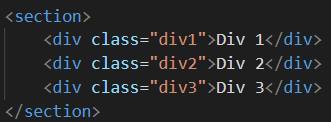

### 6. Menggunakan CSS Float Property

Selanjutnya, tambahkan deklarasi CSS pada bagian `<head>` untuk membuat elemen menggunakan properti `float`, seperti berikut.

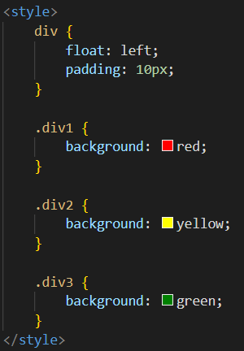

Perubahan tampilannya akan terlihat seperti pada gambar berikut.

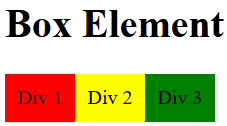

### 7. Menambahkan Elemen Div

Tambahkan elemen `
` lainnya setelah elemen `div3` seperti berikut.

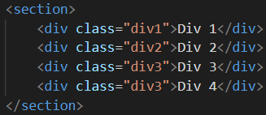

### 8. Mengatur Properti Clear pada CSS

Kemudian, atur properti `clear` pada CSS seperti berikut.

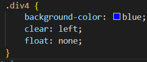

Tampilan akan terlihat seperti pada gambar berikut.

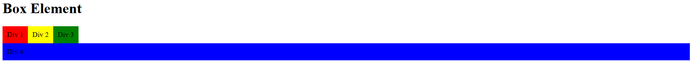

### 9. Melakukan Eksperimen Properti Clear

Lakukan eksperimen terhadap penggunaan properti `clear` dengan nilai lainnya, yaitu `left`, `right`, `both`, dan `none`. Amati perubahan tampilan yang terjadi.

**a. Mengubah nilai `clear` menjadi `right`**

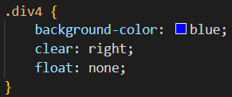

Hasil: Elemen `Div 4` akan berpindah ke bawah elemen yang mengambang di sisi kanan. Tampilan akan terlihat seperti pada gambar berikut.

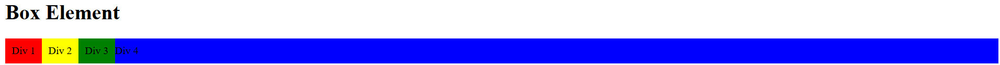

**b. Mengubah nilai `clear` menjadi `both`**

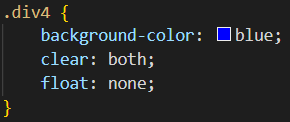

Hasil: Elemen `Div 4` akan berpindah ke bawah elemen yang mengambang di sisi kiri maupun kanan. Tampilan akan terlihat seperti pada gambar berikut.

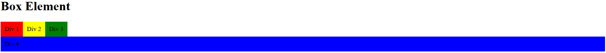

**c. Mengubah nilai `clear` menjadi `none`**

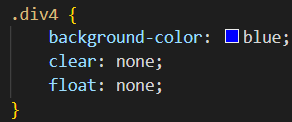

Hasil: Elemen `Div 4` tidak diwajibkan berpindah ke bawah elemen yang menggunakan `float`. Karena `float: none` membuat `Div 4` mengikuti alur normal dokumen, elemen tersebut dapat berada di samping elemen-elemen sebelumnya jika masih tersedia ruang. Tampilan akan terlihat seperti pada gambar berikut.

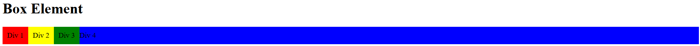

### 10. Membuat Folder dan File Layout

Buat folder baru dengan nama `lab4_layout`, kemudian buat file baru di dalamnya dengan nama `home.html` dan file CSS dengan nama `style.css`.

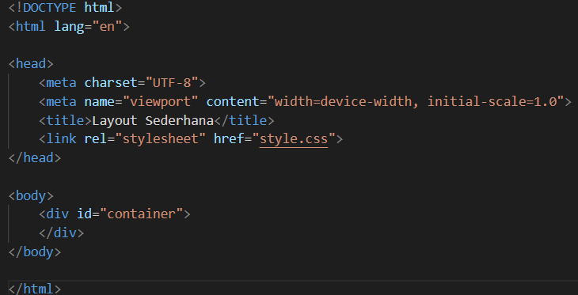

### 11. Menuliskan Kode HTML Layout

Kemudian, tuliskan kode HTML berikut pada file `home.html`.

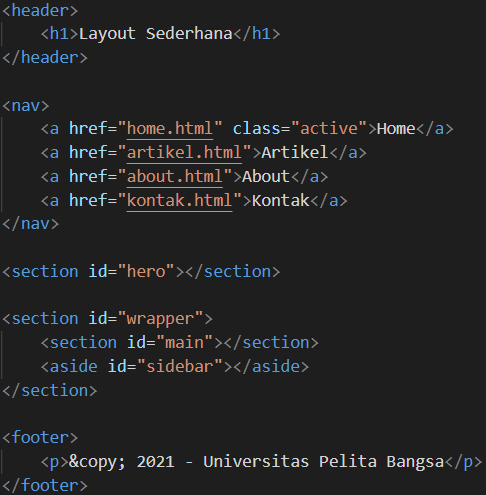

Tampilan akan terlihat seperti pada gambar berikut.

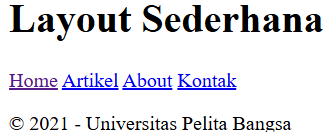

### 12. Menambahkan CSS untuk Layout

Kemudian, tambahkan kode CSS untuk membuat layout halaman web.

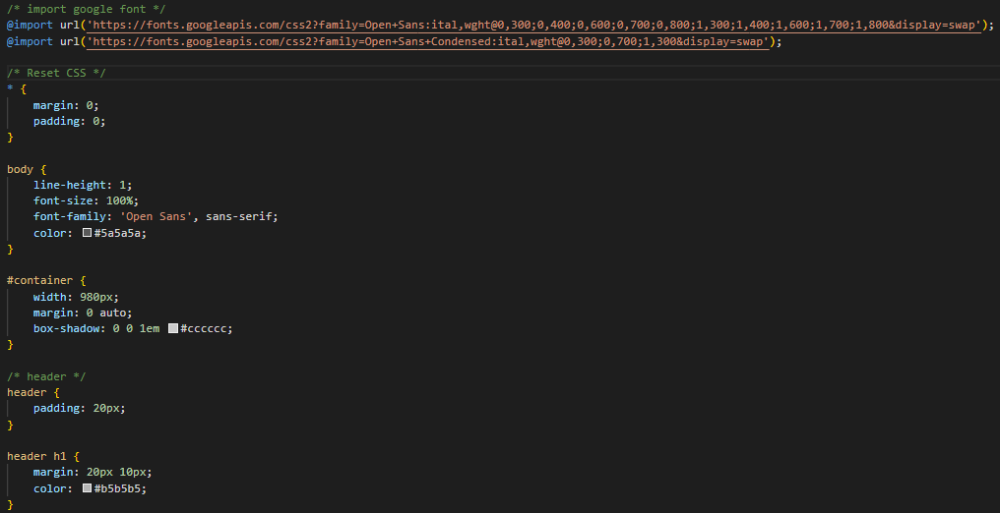

Tampilan akan terlihat seperti pada gambar berikut.

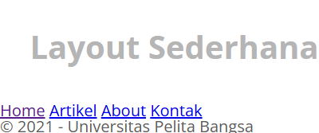

### 13. Mengatur Navigasi

Selanjutnya, atur bagian navigasi pada halaman web menggunakan kode berikut.

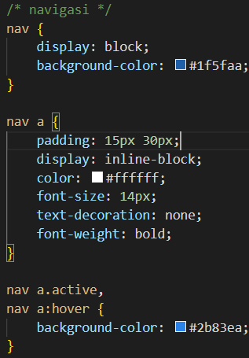

Tampilan akan terlihat seperti pada gambar berikut.

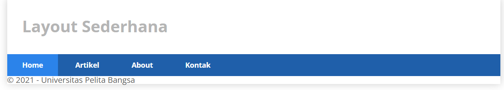

### 14. Membuat Hero Panel

Selanjutnya, buat bagian hero panel dengan menambahkan kode HTML dan CSS seperti berikut.

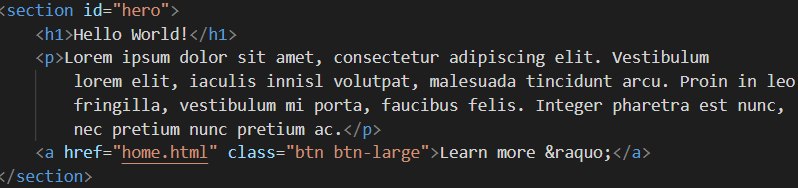

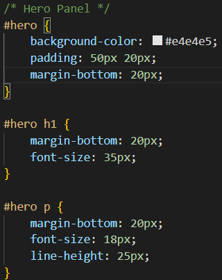

Tampilan akan terlihat seperti pada gambar berikut.

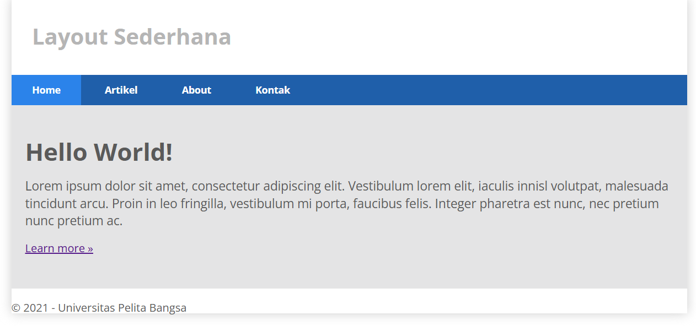

### 15. Mengatur Main Content dan Sidebar

Selanjutnya, atur bagian main content dan sidebar dengan menambahkan CSS menggunakan properti `float`.

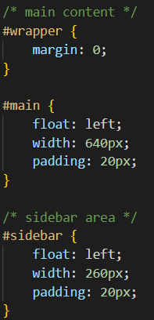

### 16. Menambahkan Elemen pada Sidebar

Selanjutnya, tambahkan elemen lainnya pada bagian sidebar.

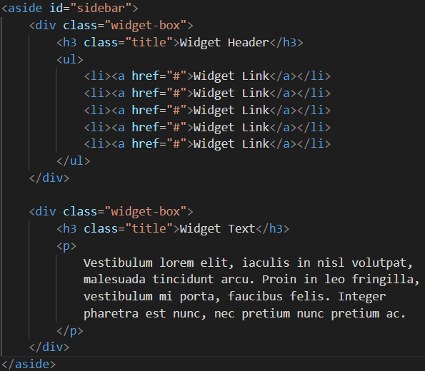

Kemudian, tambahkan CSS untuk mengatur tampilan elemen sidebar tersebut.

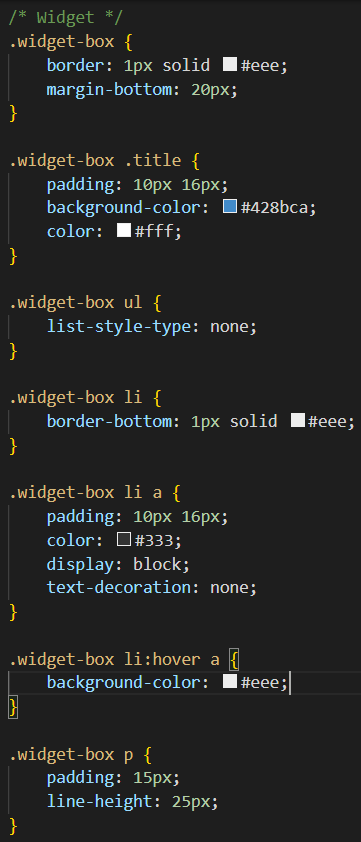

Tampilan akan terlihat seperti pada gambar berikut.

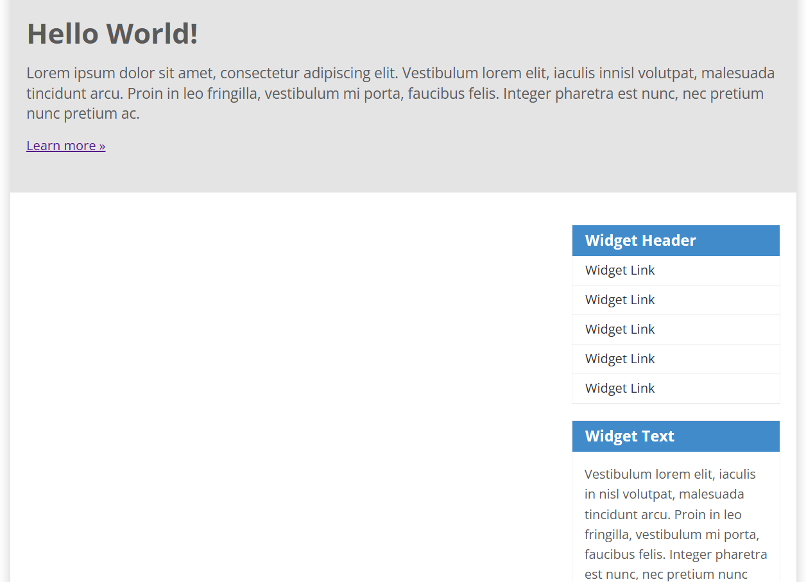

### 17. Mengatur Tampilan Footer

Selanjutnya, atur tampilan footer dengan menambahkan kode CSS berikut.

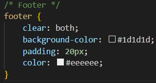

Tampilan akan terlihat seperti pada gambar berikut.

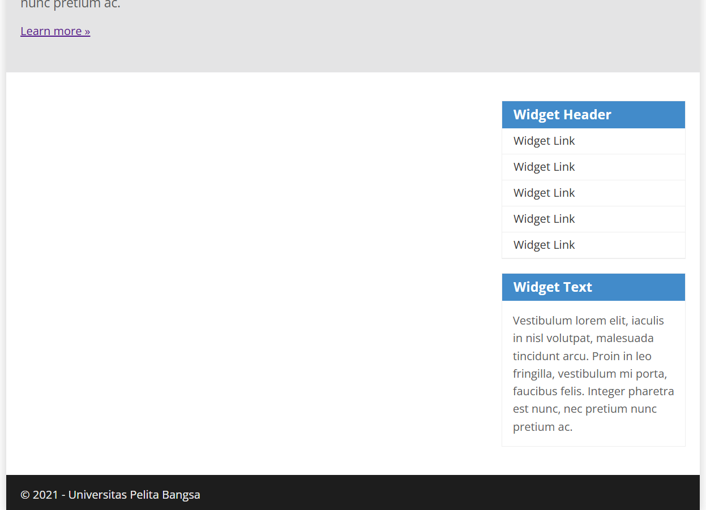

### 18. Menambahkan Elemen pada Main Content

Tambahkan elemen lainnya pada bagian main content sesuai dengan kode berikut.

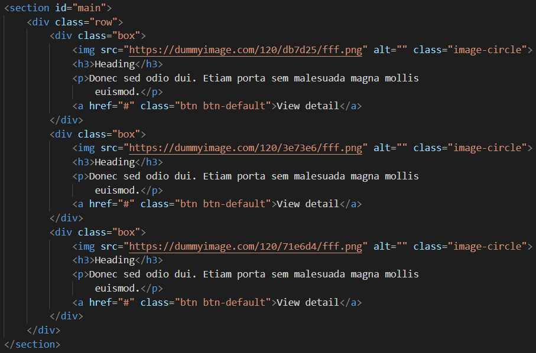

Kemudian, tambahkan CSS untuk mengatur tampilan elemen tersebut.

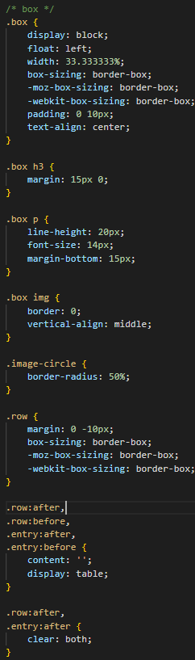

Tampilan akan terlihat seperti pada gambar berikut.

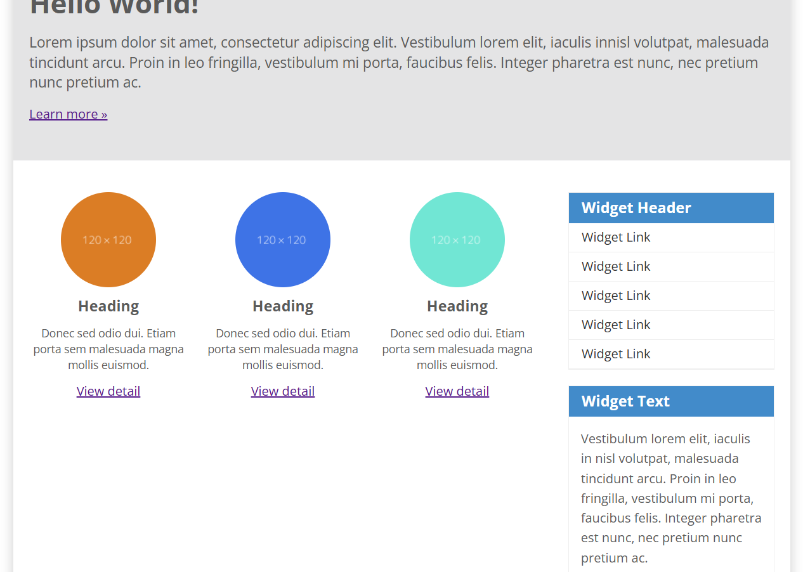

### 19. Membuat Konten Artikel

Selanjutnya, buat konten artikel dengan menambahkan kode HTML berikut pada bagian main content.

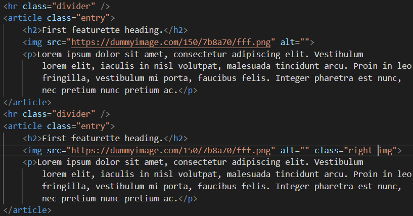

Kemudian, tambahkan CSS untuk mengatur tampilan konten artikel.

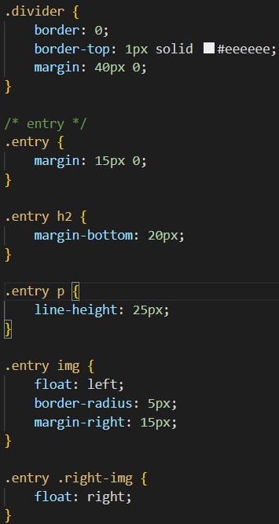

Tampilan akan terlihat seperti pada gambar berikut.

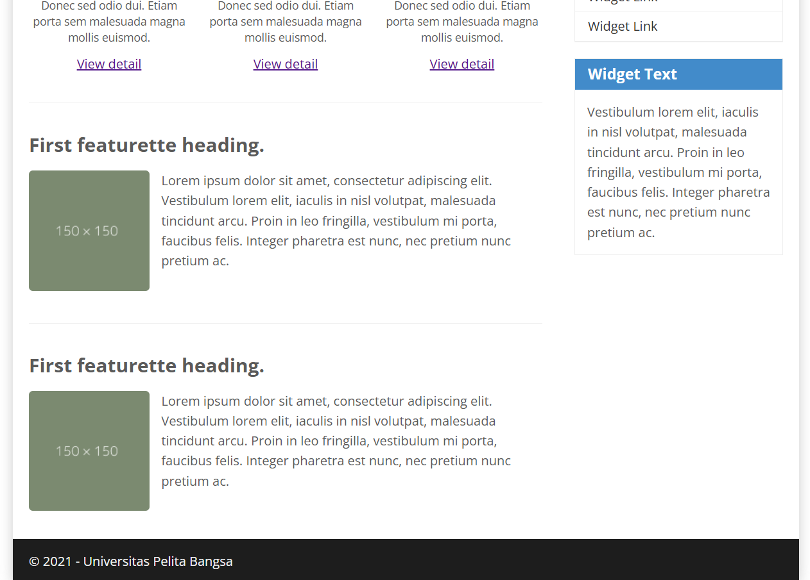
